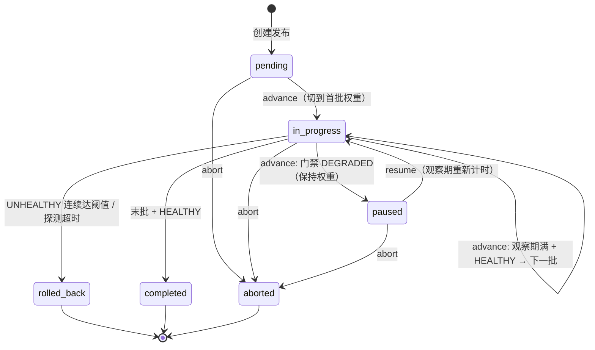

# 本地金丝雀发布编排器（Canary Release Orchestrator）

一个纯本地、可离线验证的 FastAPI 服务，模拟**金丝雀 / 蓝绿渐进式发布**：分批切流、
最小观察期、健康门禁、自动回滚、人工暂停 / 中止，并保证并发安全与重启后精确恢复。

- 只依赖本机能力与仓库已有/常规开源依赖（FastAPI、pytest）；
- 不访问任何外部服务、不需要真实凭据或付费资源；
- 健康结果由本地**脚本化探测器**注入，默认探测器在未注入时始终判定健康；
- 状态持久化在本地单个 JSON 文件中（默认 `./.release_state.json`，
  可用环境变量 `RELEASE_STATE_FILE` 覆盖），写入为临时文件 + 原子替换；
- **支持多实例协作**：多个本地服务进程（或同进程多线程）把 `RELEASE_STATE_FILE`
  指向同一个文件即可共享发布状态，跨进程互斥、乐观版本与滚动重启安全
  （见第 9 节）。

> 兼容性：原有入口 `GET /` 保持不变，仍返回 `{"Hello": "World"}`。

---

## 1. 快速开始

```bash
uv sync                                  # 安装依赖（含 pytest 开发依赖）
uv run pytest -q                         # 运行全部本地测试（43 个，含多实例）
uv run uvicorn main:app --port 8000      # 启动服务
```

创建并推进一个发布（权重 20% -> 100%，每批观察 1 秒）：

```bash
curl -s -X POST localhost:8000/releases -H 'Content-Type: application/json' -d '{
  "name": "checkout-service",
  "candidate": "v2.0.0",
  "stable": "v1.9.0",
  "weights": [20, 100],
  "min_observe_seconds": 1,
  "max_consecutive_failures": 3
}'
# 记下返回的 id

curl -X POST localhost:8000/releases/<id>/advance   # started   -> 候选 20%
curl -X POST localhost:8000/releases/<id>/advance   # 观察期未满 -> 409 duplicate_advance
sleep 1
curl -X POST localhost:8000/releases/<id>/advance   # advanced  -> 候选 100%
sleep 1
curl -X POST localhost:8000/releases/<id>/advance   # completed -> v2.0.0 全量
curl localhost:8000/releases/<id>/events            # 查看带判定依据的审计事件链
```

---

## 2. 发布状态流转

状态机定义于 `release_orchestrator/models.py`：

| 状态 | 含义 |
| --- | --- |
| `pending` | 已创建，尚未推进（流量 100% 在稳定版本） |
| `in_progress` | 金丝雀推进中，当前批次已切权重、处于观察期 / 门禁判定中 |
| `paused` | 健康门禁判定**降级**而暂停；保持当前权重，等待人工 `resume` |
| `completed` | 终态：全部批次通过，候选版本 100% |
| `rolled_back` | 终态：触发自动回滚，候选权重归零，100% 回到稳定版本 |
| `aborted` | 终态：人工中止；**冻结当前流量**，不自动回滚 |



### `advance` 的一次调用做了什么

1. `pending`：切到第一批权重（如候选 10% / 稳定 90%），记录批次开始时间，进入观察期；
2. `in_progress`：
   - 距批次开始不足 `min_observe_seconds` → 拒绝（`duplicate_advance`），**不切权重**；
   - 观察期满 → 调用本地健康探测器，按判定执行（见下节）；
3. `paused` → 拒绝（`duplicate_advance`，提示先 `resume`）；
4. `aborted` → `manual_abort`；`completed` / `rolled_back` → `illegal_transition`。

每一步都会追加审计事件（`release_created` / `traffic_switched` / `batch_completed`
/ `gate_unhealthy` / `gate_paused` / `gate_probe_timeout` / `rollback` /
`manual_abort` / `resumed` …），事件带时间戳、输入快照与 `decision` 判定依据。

---

## 3. 健康门禁与异常处置

探测器协议 `HealthProbe.probe(release_id, candidate, weight)`（见
`release_orchestrator/health.py`），返回三种判定或抛异常：

| 判定 / 异常 | 处置 | 异常链路（可程序化区分） |
| --- | --- | --- |
| `healthy` | 当前批次完成；非末批则切下一批权重并重新计时，末批则 `completed` | — |
| `degraded` | 进入 `paused`，**保持当前权重**，等待人工恢复 | HTTP 200，`action=paused` |
| `unhealthy` | 连续失败计数 +1；**未达阈值**保持权重并拒绝本次推进；**达到阈值**立即回滚 | 未达阈值：409 `duplicate_advance`；达阈值：**502 `consecutive_failure`** |
| 探测超时（抛 `ProbeTimeoutError`） | **立即回滚**，不等阈值 | **504 `probe_timeout`** |
| 人工中止 | 冻结流量进入 `aborted`，不自动回滚；之后推进/恢复被拒绝 | 409 `manual_abort` |

- `max_consecutive_failures` 在发布计划中配置（默认 3）；一次 `healthy` 后计数清零。
- 502 / 504 响应体除错误码外还包含 `action="rolled_back"` 与回滚后的完整发布视图。
- 脚本化探测器 `ScriptedHealthProbe(verdicts=[...], timeout_at=N)` 用于测试与本地演示，
  判定序列、指标 dict、超时位置都可精确编排；未注册探测器时使用本地默认的"始终健康"探测器。

### 回滚后的一致性（可解释）

回滚完成后状态严格满足：

- `status = rolled_back`
- `current_weight = 0`（候选版本流量为 0），稳定版本权重 100%
- `active_version = <stable>`
- `rollback_reason` 记录触发原因（超时 / 连续失败次数与阈值）
- 事件链中有且仅有一次 `rollback` 事件

存储层在加载时还会校验上述一致性，发现自相矛盾的历史记录会隔离而不是带病加载。

---

## 4. HTTP 接口与拒绝结果

| 方法 / 路径 | 说明 |
| --- | --- |
| `GET /` | 兼容接口，返回 `{"Hello": "World"}` |
| `POST /releases` | 创建发布（计划非法 → 422 `invalid_plan`；同名重复 → 409 `duplicate_release`） |
| `GET /releases` | 列出全部发布 |
| `GET /releases/{id}` | 查询单个发布 |
| `POST /releases/{id}/advance` | 受控推进（返回 `action`：`started`/`advanced`/`completed`/`paused`）；body 可选 `{"expected_version": N}` |
| `POST /releases/{id}/abort` | 人工中止，body：`{"reason": "...", "expected_version": N?}` |
| `POST /releases/{id}/resume` | 从暂停恢复（观察期重新计时）；body 可选 `{"expected_version": N}` |
| `GET /releases/{id}/events` | 审计事件链 |
| `GET /health` | 服务自检，并列出被隔离的不兼容历史数据 |

错误码（JSON body：`{"error_code", "message", ...}`）：

| error_code | HTTP | 语义 |
| --- | --- | --- |
| `release_not_found` | 404 | 发布不存在 |
| `invalid_plan` | 422 | 计划参数非法 |
| `duplicate_release` | 409 | 重复提交同名发布 |
| `illegal_transition` | 409 | 终态/非法状态转换 |
| `duplicate_advance` | 409 | 观察期未满、暂停态直接推进、未达阈值的不健康、重复中止 |
| `advance_conflict` | 409 | 同一发布已有在途操作（并发冲突，本次未生效） |
| `stale_version` | 409 | 调用方携带的 `expected_version` 已陈旧，本次未生效（响应含 `current_version` 与最新发布状态） |
| `state_commit_busy` | 503 | 共享状态提交锁在限定时间内未获取（本次未生效，可安全重试） |
| `manual_abort` | 409 | 对已人工中止的发布执行推进/恢复 |
| `consecutive_failure` | 502 | 连续健康失败达阈值（已自动回滚，响应含回滚状态） |
| `probe_timeout` | 504 | 健康探测超时（已自动回滚，响应含回滚状态） |

发布视图与 advance 响应新增 `version` 字段（从 1 开始，每次生效变更单调 +1，
旧数据无该字段时按 1 处理）；`POST /advance`、`/abort`、`/resume` 的请求体
都可选携带 `expected_version`（不传时保持原有按当前阶段判定的行为）。
事件结构新增顶层 `instance_id`（执行变更的实例标识，旧事件无该字段时原样保留）。

被拒绝的调用（`stale_version`，以及终态/暂停态上的 `illegal_transition` /
`manual_abort` / `duplicate_advance`）会在事件链留下 `operation_rejected`
事件（含 `reason`、当时 `current_status/current_batch/current_weight` 与
`decision` 判定依据）并让 `version` 前进，响应体也附带最新发布视图；
`advance_conflict` / `state_commit_busy` 属于锁竞争，不留痕、不动版本。

---

## 5. 并发安全（进程内）

- 每个发布持有独立的 `asyncio.Lock`；`advance` / `abort` / `resume` 进入临界区前
  做非占用检查，已有在途操作立即返回 `advance_conflict`，**同一事件循环内对同一发布
  的并发调用只有一个有效结果**，不重复切权重、不丢状态；
- 存储写入串行化（`threading.Lock`）并采用 `os.replace` 原子替换，避免半写文件；
- 跨进程/多实例协作规则见第 9 节。
- 测试 `tests/test_concurrency_recovery.py` 与 `tests/test_api_compat.py`
  分别在编排器层（`asyncio.gather`）与 HTTP 层（多线程）验证"单赢家"语义。

## 6. 持久化、重启恢复与数据兼容

- 每次状态变更后立即落盘；重启时从文件恢复：
  - 以每批次 `completed` 标记为准，**已完成批次绝不重复执行**；
  - `current_batch` / 当前权重 / 活动版本 / 连续失败计数 / 暂停态 / `version` 全部恢复；
  - 回滚只可能发生一次（事件链中 `rollback` 唯一）。
- 记录带单调递增 `version`（创建后为 2）：每次生效变更（含陈旧拒绝事件）+1，
  供多实例做乐观并发校验（见第 9 节）。
- 文件结构带 `schema_version`（当前 1）。**本次新增字段全部是加性变更，
  旧版本写出的状态文件无需迁移即可继续使用**。加载策略：
  - **单条记录**不兼容（字段缺失、类型错误、权重与进度自相矛盾、未知状态等）
    → 移入 `quarantine` 并随状态文件持久化、写 WARNING 日志，其余记录正常加载；
  - **整个文件**损坏、根结构非法或 schema 版本更新无法兼容
    → 原件备份为 `<state>.quarantine.<时间戳>`，以空库启动，绝不阻塞服务；
  - 被隔离数据可通过 `GET /health` 的 `quarantined` 列表查看——**明确标记而非静默忽略**。

---

## 7. 多实例部署：使用边界、冲突与恢复规则

多个本地服务进程（演示 / CI 常见）只需把 `RELEASE_STATE_FILE` 指向**同一份**
状态文件即可组成共享同一发布状态的集群：

```bash
RELEASE_STATE_FILE=/data/release.json RELEASE_INSTANCE_ID=node-1 \
  uv run uvicorn main:app --port 8001 &
RELEASE_STATE_FILE=/data/release.json RELEASE_INSTANCE_ID=node-2 \
  uv run uvicorn main:app --port 8002 &
```

`RELEASE_INSTANCE_ID` 可选：固定实例标识（出现在审计事件与 `GET /health` 中，
便于区分是哪个实例执行了变更）；不指定时每进程自动生成。

### 7.1 互斥与单赢家

- 每个发布在 `<状态文件目录>/.locks/` 下有一把跨进程文件锁
  （`release-<id>.lock`，基于 `fcntl.flock`，由内核在持锁进程退出时自动释放）。
  `advance` / `resume` / `abort` **非阻塞抢锁**：同一发布被多个实例同时操作时，
  恰好一个调用真正执行，其余立即得到 `409 advance_conflict`（本次未生效）。
  因此同一次流量切换不会执行两遍，门禁探测不会对同一批次重复计数。
- **健康门禁探测在全局提交锁之外执行**（此时只持有该发布自己的发布锁）：
  某条发布的探测再慢、甚至卡住，也只占用它自己的发布锁——
  **不相关发布的推进/恢复/中止照常立即生效**，不会被拖着等待，
  更不会因此得到 `state_commit_busy`。
- 另有一把毫秒级全局提交锁 `global.state.lock`，只在"重读盘上最新快照 →
  应用已完成的探测结果 → 原子落盘"期间短暂持有。**不同发布各有独立的发布锁，
  互不排队堵住**：不同发布的操作只在这毫秒级的提交阶段可能短暂相遇。
- 若全局提交锁在限定时限内（默认 5s）未获取，返回 `503 state_commit_busy`：
  本次未生效、未写任何状态，调用方可安全重试。该等待是有上限的，
  且**只影响当前这一条调用**，不连累其他发布，接口也不会长时间卡住。

### 7.2 不同发布互不阻塞的使用边界

| 场景 | 行为 |
| --- | --- |
| 发布 A 探测慢/卡住，操作无关发布 B | **直接成功**：B 的 advance/resume/abort 只等毫秒级提交锁，立即生效 |
| 同一发布被多实例同时 advance/resume/abort | 恰好一个生效，其余**立即** `409 advance_conflict`（非阻塞，不排队） |
| 多发布同时落盘的瞬时提交竞争 | 在全局提交锁上**短暂等待**（毫秒级，上限 `commit_timeout`），通常调用方无感 |
| 提交锁等待超过 `commit_timeout`（极端压力） | 当前调用 `503 state_commit_busy`，未写任何状态，可安全重试；其他发布不受影响 |
| 对终态/暂停态发布的推进/恢复/中止 | **明确拒绝**（`illegal_transition`/`manual_abort`/`duplicate_advance`）并留痕（见 7.3），状态不被改动 |

### 7.3 总是以共享状态最新进度为准（防陈旧覆盖）

- 实例内存中的发布记录只是**查询缓存**：任何一次变更都在锁内重新读取盘上的
  最新快照后再计算。运行很久的实例、暂停后继续的实例、滚动重启回来的实例，
  都**不可能拿旧进度覆盖他人已推进/完成/回滚的结果**；终态不会被写回进行中、
  批次不会重复完成。
- 查询接口（`GET /releases`、`GET /releases/{id}`、`/events`、`/health`）
  同样每次重读最新快照，总是反映其他实例刚提交的结果。

### 7.4 乐观版本与"未生效"的可区分结果

- 发布视图含 `version`，每次生效变更（含被记录的拒绝）单调 +1。
- 调用方可在请求体携带 `expected_version`（推进/中止/恢复均支持，可选）。
  当共享状态版本已不一致：
  - 返回 `409 stale_version`，响应体带 `expected_version`、`current_version`
    与最新发布完整视图，调用方据此明确知道"这次没生效"，重新查询后再决策；
  - 事件链追加一条 `operation_rejected`（`reason=stale_version`，含
    `current_status/current_batch/decision`），**拒绝原因在查询与事件记录里都
    看得见**，版本也前进一格。
- **不带 `expected_version` 时，对终态（completed/rolled_back/aborted）或
  暂停等待中发布的推进/恢复/中止同样留痕**：调用仍按原有错误码拒绝
  （`illegal_transition` / `manual_abort` / `duplicate_advance`），
  事件链追加 `operation_rejected`（`reason` 为 `terminal_status` /
  `already_aborted` / `paused_waiting_resume` / `not_paused`，含当时状态、
  批次与判定依据），`version` 相应前进——但**拒绝本身绝不改动发布的实际
  状态、当前权重与已完成批次**，事后排查能在查询结果与事件记录里看到
  "这次调用被拒绝过、为什么"。
- `409 advance_conflict`（锁竞争，毫秒级重试即可）不写事件、不动版本；
  观察期未满的 `duplicate_advance` 会记录 `advance_rejected` 事件。

推荐调用姿势：先 `GET` 拿到 `version` → 操作时回传 `expected_version`；
收到 `advance_conflict` / `state_commit_busy` 可直接重试；收到 `stale_version`
则以响应里的最新状态重新决策。

### 7.5 使用边界（本地/CI 语义，不承诺的场景）

- 锁基于 POSIX `fcntl.flock`：适用于 Linux/macOS 本地磁盘与 CI，
  **不支持 Windows**，也不保证 NFS/网络盘等非常规文件系统上的锁语义；
- 目标是"本机多进程共享一个文件"，不是分布式数据库：不做跨主机锁租约、
  不做跨实例健康探测协调（探测器仍是各进程本地注入，多实例时应注入行为一致的
  判定来源）；
- 整文件原子替换保证读端永远看到完整 JSON；状态文件被外部进程并发改写到
  schema 不一致时，实例会拒绝在其上写入（宁可本次调用失败也不覆盖数据）。

### 7.6 兼容范围

- 旧版本写出的状态文件（无 `version`、事件无 `instance_id`、`schema_version=1`）
  **原样可用**：记录按 `version=1` 加载，旧事件保持不变，之后正常续跑；
- 单条不兼容记录继续移入 `quarantine` 并在 `/health` 暴露；整文件损坏继续
  备份为 `.quarantine.<时间戳>` 后空库启动（见第 6 节），不静默丢数据。

---

## 8. 本地验证

```bash
# 全部测试：正常推进 / 重复请求 / 并发推进 / 重启恢复 /
# 健康失败 / 连续失败回滚 / 探测超时回滚 / 暂停恢复 / 人工中止 /
# 非法状态转换 / 脏数据隔离 / 入口兼容 /
# 多进程同发布单赢家 / 陈旧实例拒绝 / 不同发布并行 /
# 慢探测下无关发布不被拖住（进程内 + 多进程）/ 终态与暂停态拒绝留痕 /
# 滚动重启一致性 / 高压并发状态完整性 / 真实双 uvicorn 进程 HTTP 协作
uv run pytest -q
```

测试过程中 INFO 日志会打印：

- **输入**：每次 API 调用 / advance 的状态、批次、权重、活动版本；
- **状态变化**：如 `PENDING -> IN_PROGRESS batch=1 weight=10`；
- **判定依据**：探测判定 `verdict / reason / metrics`、观察期 `elapsed vs required`、
  连续失败计数 `failures/threshold`、每个事件的 `decision` 文本；
- **多实例判定**：`conflict rejected ... flock held by another instance`、
  `stale rejected ... expected=vN current=vM`、`committed ... version=vK`、
  `op rejected ... reason=terminal_status/already_aborted/...`（拒绝留痕）。

多实例相关测试：

| 测试文件 | 覆盖 |
| --- | --- |
| `tests/test_multi_instance.py` | 多进程同发布推进/中止单赢家、陈旧 advance/abort/resume 拒绝、回滚终态防复活、暂停实例防覆盖、不同发布并行、**慢探测卡住时无关发布照常完成（多进程）**、滚动重启接力、高压并发状态完整性、同进程多实例版本单调 |
| `tests/test_cross_release_isolation.py` | 进程内多线程：一条发布探测卡住时，无关发布的推进/中止/恢复在合理时间内生效（不报 `state_commit_busy`）；同发布并发仍单赢家、探测不重复 |
| `tests/test_rejection_trace.py` | 终态（completed/rolled_back/aborted）与暂停态、未带 `expected_version` 的拒绝调用：`operation_rejected` 事件留痕、`version` 前进、状态/权重/批次不变 |
| `tests/test_multi_instance_http.py` | 两个真实 uvicorn 进程共享状态文件：跨进程单赢家、`stale_version` 409、事件共享、新进程重启接力 |
| `tests/_multi_process_worker.py` | 多进程测试的子进程入口（独立文件以兼容 spawn/forkserver；支持注入慢探测） |

也可以手动起两个 uvicorn（见第 7 节开头），用 curl 分别打两个端口验证，
包括 kill 掉一个进程后用新进程接力。

## 9. 代码结构

```
main.py                              # FastAPI 入口（保持 GET / 兼容），挂载编排器单例
release_orchestrator/
  models.py                          # 状态枚举、计划/批次/记录（含乐观 version）等领域模型
  errors.py                          # 可区分异常类型（每种拒绝/失败链路一个类）
  health.py                          # 探测协议、脚本化探测器、注册表、默认健康探测器
  locking.py                         # fcntl.flock 跨进程文件锁（每发布锁 + 全局提交锁）
  storage.py                         # JSON 原子持久化、schema 校验、脏数据隔离、锁内重读快照
  orchestrator.py                    # 推进状态机、门禁、回滚/中止/恢复、双层锁与版本协作
  schemas.py                         # HTTP 请求/响应模型（expected_version 可选）
  api.py                             # REST 路由与异常->错误码映射
tests/                               # 43 个本地测试 + conftest（可控时钟/临时状态库）
```
