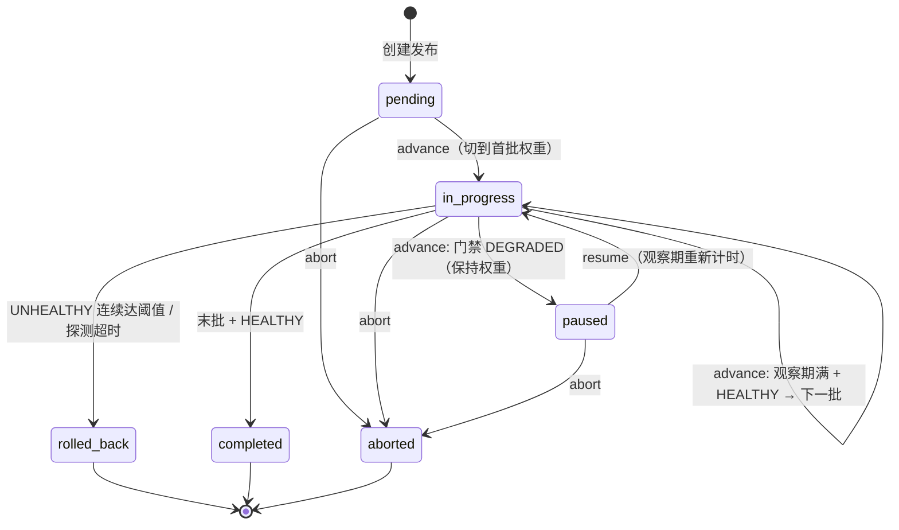

# 本地金丝雀发布编排器（Canary Release Orchestrator）

一个纯本地、可离线验证的 FastAPI 服务，模拟**金丝雀 / 蓝绿渐进式发布**：分批切流、
最小观察期、健康门禁、自动回滚、人工暂停 / 中止，并保证并发安全与重启后精确恢复。

- 只依赖本机能力与仓库已有/常规开源依赖（FastAPI、pytest）；
- 不访问任何外部服务、不需要真实凭据或付费资源；
- 健康结果由本地**脚本化探测器**注入，默认探测器在未注入时始终判定健康；
- 状态持久化在本地单个 JSON 文件中（默认 `./.release_state.json`，
  可用环境变量 `RELEASE_STATE_FILE` 覆盖），写入为临时文件 + 原子替换。

> 兼容性：原有入口 `GET /` 保持不变，仍返回 `{"Hello": "World"}`。

---

## 1. 快速开始

```bash
uv sync                                  # 安装依赖（含 pytest 开发依赖）
uv run pytest -q                         # 运行全部本地测试（21 个）
uv run uvicorn main:app --port 8000      # 启动服务
```

创建并推进一个发布（权重 20% -> 100%，每批观察 1 秒）：

```bash
curl -s -X POST localhost:8000/releases -H 'Content-Type: application/json' -d '{
  "name": "checkout-service",
  "candidate": "v2.0.0",
  "stable": "v1.9.0",
  "weights": [20, 100],
  "min_observe_seconds": 1,
  "max_consecutive_failures": 3
}'
# 记下返回的 id

curl -X POST localhost:8000/releases/<id>/advance   # started   -> 候选 20%
curl -X POST localhost:8000/releases/<id>/advance   # 观察期未满 -> 409 duplicate_advance
sleep 1
curl -X POST localhost:8000/releases/<id>/advance   # advanced  -> 候选 100%
sleep 1
curl -X POST localhost:8000/releases/<id>/advance   # completed -> v2.0.0 全量
curl localhost:8000/releases/<id>/events            # 查看带判定依据的审计事件链
```

---

## 2. 发布状态流转

状态机定义于 `release_orchestrator/models.py`：

| 状态 | 含义 |
| --- | --- |
| `pending` | 已创建，尚未推进（流量 100% 在稳定版本） |
| `in_progress` | 金丝雀推进中，当前批次已切权重、处于观察期 / 门禁判定中 |
| `paused` | 健康门禁判定**降级**而暂停；保持当前权重，等待人工 `resume` |
| `completed` | 终态：全部批次通过，候选版本 100% |
| `rolled_back` | 终态：触发自动回滚，候选权重归零，100% 回到稳定版本 |
| `aborted` | 终态：人工中止；**冻结当前流量**，不自动回滚 |



### `advance` 的一次调用做了什么

1. `pending`：切到第一批权重（如候选 10% / 稳定 90%），记录批次开始时间，进入观察期；
2. `in_progress`：
   - 距批次开始不足 `min_observe_seconds` → 拒绝（`duplicate_advance`），**不切权重**；
   - 观察期满 → 调用本地健康探测器，按判定执行（见下节）；
3. `paused` → 拒绝（`duplicate_advance`，提示先 `resume`）；
4. `aborted` → `manual_abort`；`completed` / `rolled_back` → `illegal_transition`。

每一步都会追加审计事件（`release_created` / `traffic_switched` / `batch_completed`
/ `gate_unhealthy` / `gate_paused` / `gate_probe_timeout` / `rollback` /
`manual_abort` / `resumed` …），事件带时间戳、输入快照与 `decision` 判定依据。

---

## 3. 健康门禁与异常处置

探测器协议 `HealthProbe.probe(release_id, candidate, weight)`（见
`release_orchestrator/health.py`），返回三种判定或抛异常：

| 判定 / 异常 | 处置 | 异常链路（可程序化区分） |
| --- | --- | --- |
| `healthy` | 当前批次完成；非末批则切下一批权重并重新计时，末批则 `completed` | — |
| `degraded` | 进入 `paused`，**保持当前权重**，等待人工恢复 | HTTP 200，`action=paused` |
| `unhealthy` | 连续失败计数 +1；**未达阈值**保持权重并拒绝本次推进；**达到阈值**立即回滚 | 未达阈值：409 `duplicate_advance`；达阈值：**502 `consecutive_failure`** |
| 探测超时（抛 `ProbeTimeoutError`） | **立即回滚**，不等阈值 | **504 `probe_timeout`** |
| 人工中止 | 冻结流量进入 `aborted`，不自动回滚；之后推进/恢复被拒绝 | 409 `manual_abort` |

- `max_consecutive_failures` 在发布计划中配置（默认 3）；一次 `healthy` 后计数清零。
- 502 / 504 响应体除错误码外还包含 `action="rolled_back"` 与回滚后的完整发布视图。
- 脚本化探测器 `ScriptedHealthProbe(verdicts=[...], timeout_at=N)` 用于测试与本地演示，
  判定序列、指标 dict、超时位置都可精确编排；未注册探测器时使用本地默认的"始终健康"探测器。

### 回滚后的一致性（可解释）

回滚完成后状态严格满足：

- `status = rolled_back`
- `current_weight = 0`（候选版本流量为 0），稳定版本权重 100%
- `active_version = <stable>`
- `rollback_reason` 记录触发原因（超时 / 连续失败次数与阈值）
- 事件链中有且仅有一次 `rollback` 事件

存储层在加载时还会校验上述一致性，发现自相矛盾的历史记录会隔离而不是带病加载。

---

## 4. HTTP 接口与拒绝结果

| 方法 / 路径 | 说明 |
| --- | --- |
| `GET /` | 兼容接口，返回 `{"Hello": "World"}` |
| `POST /releases` | 创建发布（计划非法 → 422 `invalid_plan`；同名重复 → 409 `duplicate_release`） |
| `GET /releases` | 列出全部发布 |
| `GET /releases/{id}` | 查询单个发布 |
| `POST /releases/{id}/advance` | 受控推进（返回 `action`：`started`/`advanced`/`completed`/`paused`） |
| `POST /releases/{id}/abort` | 人工中止，body：`{"reason": "..."}` |
| `POST /releases/{id}/resume` | 从暂停恢复（观察期重新计时） |
| `GET /releases/{id}/events` | 审计事件链 |
| `GET /health` | 服务自检，并列出被隔离的不兼容历史数据 |

错误码（JSON body：`{"error_code", "message", ...}`）：

| error_code | HTTP | 语义 |
| --- | --- | --- |
| `release_not_found` | 404 | 发布不存在 |
| `invalid_plan` | 422 | 计划参数非法 |
| `duplicate_release` | 409 | 重复提交同名发布 |
| `illegal_transition` | 409 | 终态/非法状态转换 |
| `duplicate_advance` | 409 | 观察期未满、暂停态直接推进、未达阈值的不健康、重复中止 |
| `advance_conflict` | 409 | 同一发布已有在途操作（并发冲突，本次未生效） |
| `manual_abort` | 409 | 对已人工中止的发布执行推进/恢复 |
| `consecutive_failure` | 502 | 连续健康失败达阈值（已自动回滚，响应含回滚状态） |
| `probe_timeout` | 504 | 健康探测超时（已自动回滚，响应含回滚状态） |

---

## 5. 并发安全

- 每个发布持有独立的 `asyncio.Lock` 与"在途操作"标志（`orchestrator.py`）；
  `advance` / `abort` / `resume` 进入临界区前做非占用检查，已有在途操作立即返回
  `advance_conflict`，**同一发布的并发推进只有一个有效结果**，不重复切权重、不丢状态；
- 存储写入串行化（`threading.Lock`）并采用 `os.replace` 原子替换，避免半写文件；
- 测试 `tests/test_concurrency_recovery.py` 与 `tests/test_api_compat.py`
  分别在编排器层（`asyncio.gather`）与 HTTP 层（多线程）验证"单赢家"语义。

## 6. 持久化、重启恢复与数据兼容

- 每次状态变更后立即落盘；重启时从文件恢复：
  - 以每批次 `completed` 标记为准，**已完成批次绝不重复执行**；
  - `current_batch` / 当前权重 / 活动版本 / 连续失败计数 / 暂停态全部恢复；
  - 回滚只可能发生一次（事件链中 `rollback` 唯一）。
- 文件结构带 `schema_version`（当前 1）。加载策略：
  - **单条记录**不兼容（字段缺失、类型错误、权重与进度自相矛盾、未知状态等）
    → 移入 `quarantine` 并随状态文件持久化、写 WARNING 日志，其余记录正常加载；
  - **整个文件**损坏、根结构非法或 schema 版本更新无法兼容
    → 原件备份为 `<state>.quarantine.<时间戳>`，以空库启动，绝不阻塞服务；
  - 被隔离数据可通过 `GET /health` 的 `quarantined` 列表查看——**明确标记而非静默忽略**。

---

## 7. 本地验证

```bash
# 全部测试：正常推进 / 重复请求 / 并发推进 / 重启恢复 /
# 健康失败 / 连续失败回滚 / 探测超时回滚 / 暂停恢复 / 人工中止 /
# 非法状态转换 / 脏数据隔离 / 入口兼容
uv run pytest -q
```

测试过程中 INFO 日志会打印：

- **输入**：每次 API 调用 / advance 的状态、批次、权重、活动版本；
- **状态变化**：如 `PENDING -> IN_PROGRESS batch=1 weight=10`；
- **判定依据**：探测判定 `verdict / reason / metrics`、观察期 `elapsed vs required`、
  连续失败计数 `failures/threshold`、每个事件的 `decision` 文本。

也可以按"快速开始"用真实 uvicorn + curl 验证（包括 kill 进程后重启续跑）。

## 8. 代码结构

```
main.py                              # FastAPI 入口（保持 GET / 兼容），挂载编排器单例
release_orchestrator/
  models.py                          # 状态枚举、计划/批次/记录等领域模型
  errors.py                          # 可区分异常类型（每种拒绝/失败链路一个类）
  health.py                          # 探测协议、脚本化探测器、注册表、默认健康探测器
  storage.py                         # JSON 原子持久化、schema 校验、脏数据隔离
  orchestrator.py                    # 推进状态机、门禁、回滚/中止/恢复、并发控制
  schemas.py                         # HTTP 请求/响应模型
  api.py                             # REST 路由与异常->错误码映射
tests/                               # 21 个本地测试 + conftest（可控时钟/临时状态库）
```
