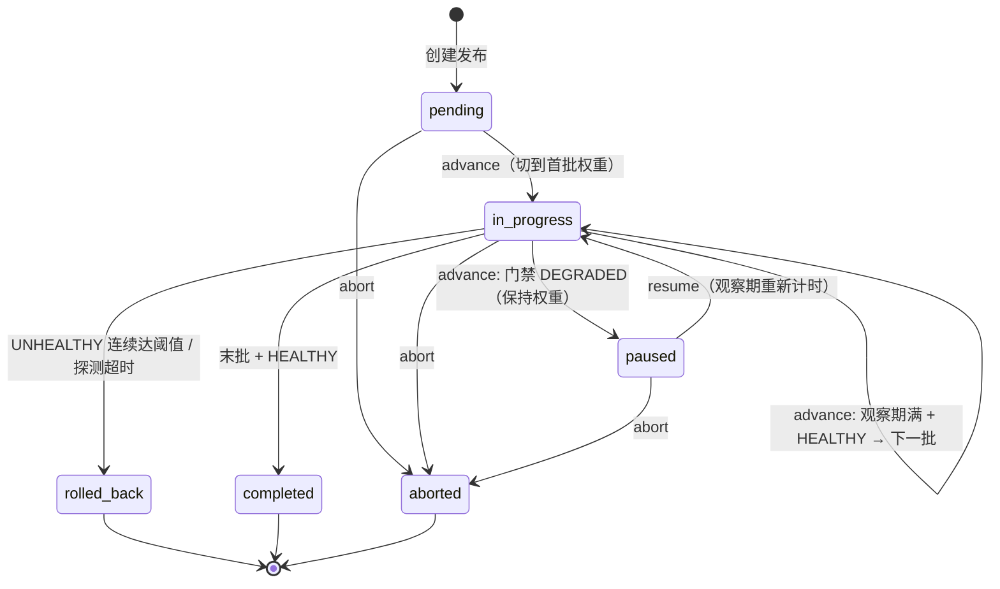

# 本地金丝雀发布编排器（Canary Release Orchestrator）

一个纯本地、可离线验证的 FastAPI 服务，模拟**金丝雀 / 蓝绿渐进式发布**：分批切流、
最小观察期、健康门禁、自动回滚、人工暂停 / 中止，并保证**单实例与多实例**下的
并发安全、跨进程协作与重启后精确恢复。

- 只依赖本机能力与仓库已有/常规开源依赖（FastAPI、pytest）；
- 不访问任何外部服务、不需要真实凭据或付费资源；
- 健康结果由本地**脚本化探测器**注入，默认探测器在未注入时始终判定健康；
- 状态持久化在本地单个 JSON 文件中（默认 `./.release_state.json`，
  可用环境变量 `RELEASE_STATE_FILE` 覆盖），写入为临时文件 + 原子替换；
- **多实例**：多个服务进程（本地演示、CI 或滚动重启）可把 `RELEASE_STATE_FILE`
  指向同一文件共享发布状态。每发布一把跨进程操作锁 + 乐观版本号，
  保证同一发布同时只有一个操作生效、陈旧实例不覆盖新结果，且不同发布互不排队。

> 兼容性：原有入口 `GET /` 保持不变，仍返回 `{"Hello": "World"}`。

---

## 1. 快速开始

```bash
uv sync                                  # 安装依赖（含 pytest 开发依赖）
uv run pytest -q                         # 运行全部本地测试（34 个，含多进程协作）
uv run uvicorn main:app --port 8000      # 启动服务
```

创建并推进一个发布（权重 20% -> 100%，每批观察 1 秒）：

```bash
curl -s -X POST localhost:8000/releases -H 'Content-Type: application/json' -d '{
  "name": "checkout-service",
  "candidate": "v2.0.0",
  "stable": "v1.9.0",
  "weights": [20, 100],
  "min_observe_seconds": 1,
  "max_consecutive_failures": 3
}'
# 记下返回的 id

curl -X POST localhost:8000/releases/<id>/advance   # started   -> 候选 20%
curl -X POST localhost:8000/releases/<id>/advance   # 观察期未满 -> 409 duplicate_advance
sleep 1
curl -X POST localhost:8000/releases/<id>/advance   # advanced  -> 候选 100%
sleep 1
curl -X POST localhost:8000/releases/<id>/advance   # completed -> v2.0.0 全量
curl localhost:8000/releases/<id>/events            # 查看带判定依据的审计事件链
```

---

## 2. 发布状态流转

状态机定义于 `release_orchestrator/models.py`：

| 状态 | 含义 |
| --- | --- |
| `pending` | 已创建，尚未推进（流量 100% 在稳定版本） |
| `in_progress` | 金丝雀推进中，当前批次已切权重、处于观察期 / 门禁判定中 |
| `paused` | 健康门禁判定**降级**而暂停；保持当前权重，等待人工 `resume` |
| `completed` | 终态：全部批次通过，候选版本 100% |
| `rolled_back` | 终态：触发自动回滚，候选权重归零，100% 回到稳定版本 |
| `aborted` | 终态：人工中止；**冻结当前流量**，不自动回滚 |



### `advance` 的一次调用做了什么

1. `pending`：切到第一批权重（如候选 10% / 稳定 90%），记录批次开始时间，进入观察期；
2. `in_progress`：
   - 距批次开始不足 `min_observe_seconds` → 拒绝（`duplicate_advance`），**不切权重**；
   - 观察期满 → 调用本地健康探测器，按判定执行（见下节）；
3. `paused` → 拒绝（`duplicate_advance`，提示先 `resume`）；
4. `aborted` → `manual_abort`；`completed` / `rolled_back` → `illegal_transition`。

每一步都会追加审计事件（`release_created` / `traffic_switched` / `batch_completed`
/ `gate_unhealthy` / `gate_paused` / `gate_probe_timeout` / `rollback` /
`manual_abort` / `resumed` …），事件带时间戳、输入快照与 `decision` 判定依据。

---

## 3. 健康门禁与异常处置

探测器协议 `HealthProbe.probe(release_id, candidate, weight)`（见
`release_orchestrator/health.py`），返回三种判定或抛异常：

| 判定 / 异常 | 处置 | 异常链路（可程序化区分） |
| --- | --- | --- |
| `healthy` | 当前批次完成；非末批则切下一批权重并重新计时，末批则 `completed` | — |
| `degraded` | 进入 `paused`，**保持当前权重**，等待人工恢复 | HTTP 200，`action=paused` |
| `unhealthy` | 连续失败计数 +1；**未达阈值**保持权重并拒绝本次推进；**达到阈值**立即回滚 | 未达阈值：409 `duplicate_advance`；达阈值：**502 `consecutive_failure`** |
| 探测超时（抛 `ProbeTimeoutError`） | **立即回滚**，不等阈值 | **504 `probe_timeout`** |
| 人工中止 | 冻结流量进入 `aborted`，不自动回滚；之后推进/恢复被拒绝 | 409 `manual_abort` |

- `max_consecutive_failures` 在发布计划中配置（默认 3）；一次 `healthy` 后计数清零。
- 502 / 504 响应体除错误码外还包含 `action="rolled_back"` 与回滚后的完整发布视图。
- 脚本化探测器 `ScriptedHealthProbe(verdicts=[...], timeout_at=N)` 用于测试与本地演示，
  判定序列、指标 dict、超时位置都可精确编排；未注册探测器时使用本地默认的"始终健康"探测器。

### 回滚后的一致性（可解释）

回滚完成后状态严格满足：

- `status = rolled_back`
- `current_weight = 0`（候选版本流量为 0），稳定版本权重 100%
- `active_version = <stable>`
- `rollback_reason` 记录触发原因（超时 / 连续失败次数与阈值）
- 事件链中有且仅有一次 `rollback` 事件

存储层在加载时还会校验上述一致性，发现自相矛盾的历史记录会隔离而不是带病加载。

---

## 4. HTTP 接口与拒绝结果

| 方法 / 路径 | 说明 |
| --- | --- |
| `GET /` | 兼容接口，返回 `{"Hello": "World"}` |
| `POST /releases` | 创建发布（计划非法 → 422 `invalid_plan`；同名重复 → 409 `duplicate_release`） |
| `GET /releases` | 列出全部发布 |
| `GET /releases/{id}` | 查询单个发布 |
| `POST /releases/{id}/advance` | 受控推进（返回 `action`：`started`/`advanced`/`completed`/`paused`） |
| `POST /releases/{id}/abort` | 人工中止，body：`{"reason": "..."}` |
| `POST /releases/{id}/resume` | 从暂停恢复（观察期重新计时） |
| `GET /releases/{id}/events` | 审计事件链 |
| `GET /health` | 服务自检，并列出被隔离的不兼容历史数据 |

错误码（JSON body：`{"error_code", "message", ...}`）：

| error_code | HTTP | 语义 |
| --- | --- | --- |
| `release_not_found` | 404 | 发布不存在 |
| `invalid_plan` | 422 | 计划参数非法 |
| `duplicate_release` | 409 | 重复提交同名发布 |
| `illegal_transition` | 409 | 终态/非法状态转换（本次未生效） |
| `duplicate_advance` | 409 | 观察期未满、暂停态直接推进、未达阈值的不健康、重复中止（本次未生效） |
| `advance_conflict` | 409 | 同一发布已有在途操作：同进程在途，或**其他服务实例正持有该发布操作锁**（本次未生效） |
| `stale_state` | 409 | 本次变更基于过期进度，共享状态已被其他实例推进/完成/回滚（本次未生效） |
| `manual_abort` | 409 | 对已人工中止的发布执行推进/恢复（本次未生效） |
| `storage_busy` | 503 | 共享状态提交锁在限定时间内不可用（本次未生效，可安全重试） |
| `consecutive_failure` | 502 | 连续健康失败达阈值（已自动回滚，响应含回滚状态） |
| `probe_timeout` | 504 | 健康探测超时（已自动回滚，响应含回滚状态） |

所有 409/503 拒绝响应都带 `"effective": false`，与真正生效（200/201）的调用
明确区分；冲突与陈旧拒绝的响应体还附 `release` 字段——**共享状态中该发布的最新
视图**（含 `version`、状态、批次、权重），调用方一次响应即可判断"我的操作没生效，
别人已经把它推进到了哪里"，无需再次查询。

---

## 5. 多实例部署：协作边界、冲突与恢复

多个 uvicorn / 服务进程（本地演示、CI、滚动重启）把 `RELEASE_STATE_FILE` 指向
**同一个 JSON 文件**即组成多实例。协调机制全部基于本地文件，无外部依赖：

### 5.1 协调模型

- **每发布一把跨进程操作锁**（`fcntl.flock`，锁文件位于
  `<state>.locks/op-<release_id>.lock`）：
  - `advance` / `resume` / `abort` 进入执行前**非阻塞抢锁**，抢不到立即返回
    `advance_conflict`——同一发布被多个进程同时操作时，**恰好一个请求生效**，
    其余以可区分方式返回"未生效"；同一次流量切换绝不会执行两遍。
  - 锁**按发布隔离**：发布 X 持锁（例如在慢健康门禁里）完全不阻塞发布 Y，
    不同发布的操作不会互相排队。
  - 进程异常退出时内核自动释放 flock，不会留下死锁。
- **一把全局提交锁**（`<state>.locks/commit.lock`）：只在"读最新状态 → 合并本记录
  → 原子落盘"的极短窗口内持有（有界等待，默认 10s，超时返回 503 `storage_busy`），
  用于串行化全量重写。健康探针等耗时动作**不**持有提交锁。
- **乐观版本号**：状态文件顶层 `revision` 每次提交 +1；每条发布有独立 `version`，
  查询视图中可见。任何变更都先从磁盘读取**最新进度**作为基线，在工作副本上变更，
  提交时校验版本：
  - 版本仍是读取时的值 → 合并写回（只替换本发布，其他发布原样保留）；
  - 版本已被其他实例推进 → 拒绝写入（`stale_state`），本次操作完全不生效，
    并在最新状态的事件链追加 `operation_rejected(reason=stale_state)`。
- **查询无缓存**：`get/list/events/health` 每次直接读取磁盘最新快照，任何实例都能
  立刻看到其他实例的推进结果；`os.replace` 原子替换保证任何进程都读不到半截 JSON。

### 5.2 使用边界（多实例时需要知道的）

1. 协调依赖**同一台机器上的同一个状态文件目录**（flock 与原子替换是本地文件
   语义）。网络盘 / 对象存储 / 跨主机目录不在支持范围。
2. 健康探测器是**每个进程本地注入**的（脚本化探针）。多实例共用时，门禁判定应由
   各进程的注入策略保持一致；本服务不代发真实网络探测。
3. 冲突是**快速失败而不是排队**：被拒绝方应按错误码决策（重试 / 放弃 / 重新查询），
   不要依赖服务端把并发请求串行化成"都执行一遍"。
4. 状态文件与 `<state>.locks/` 目录需放在同一目录下一起保留；锁文件本身可留存
   复用，不必手动清理（清理时确保没有进程在运行）。

### 5.3 陈旧实例与滚动重启的恢复规则

针对"实例运行很久后再操作 / 暂停后继续 / 重启回来"的场景，规则是
**一切以共享状态的最新进度为准，最坏拒绝，绝不回退**：

| 陈旧实例持有的认知 | 共享状态实际进度 | 该实例再操作的结果 |
| --- | --- | --- |
| 进行中（旧批次） | 已被其他实例推进到后续批次/完成 | `stale_state` 或基于最新状态重新判定；旧批次进度不覆盖新结果 |
| 暂停中，准备 resume/advance | 已被其他实例回滚 | `illegal_transition`（终态），不会写回 in_progress |
| 暂停中 | 已被其他实例中止 | `manual_abort`，冻结权重不变 |
| 进行中 | 已被其他实例完成 | `illegal_transition`（终态），不会重复完成批次 |
| 任意 | 其他实例此刻正持锁操作 | `advance_conflict`（本次未生效，可重试后读到最新状态） |

- 已完成批次以 `completed` 标记 + 版本号共同保护：重启恢复绝不重复执行批次、
  不重复累计 `completed_batches`；回滚事件 `rollback` 在事件链中唯一。
- 每次"未生效/被拒绝"都会写入审计事件（`operation_rejected`，带 `op` / `reason` /
  当时状态 / `decision`），因此**查询结果和事件记录里都看得出被拒绝的原因**。
- 重启（包括滚动重启）即新建编排器从同一文件加载；加载后看到的就是最新进度。

### 5.4 单实例内并发

- 每个发布在进程内还有一把 `asyncio.Lock` + "在途操作"标志：同一事件循环内对同一
  发布的并发 `advance/abort/resume`，只有一个进入临界区，其余立即 `advance_conflict`；
- 存储写入在进程内串行（`threading.Lock`），配合跨进程提交锁与 `os.replace`
  原子替换，避免半写文件；
- 测试 `tests/test_concurrency_recovery.py`、`tests/test_api_compat.py` 与
  `tests/test_multi_instance.py` 在编排器层（`asyncio.gather`）、HTTP 层
  （多线程）和**操作系统进程层**（`multiprocessing`）分别验证"单赢家"语义。

## 6. 持久化、重启恢复与数据兼容

- 每次状态变更后立即原子落盘；重启时从文件恢复：
  - 以每批次 `completed` 标记为准，**已完成批次绝不重复执行**；
  - `current_batch` / 当前权重 / 活动版本 / 连续失败计数 / 暂停态全部恢复；
  - 回滚只可能发生一次（事件链中 `rollback` 唯一）；
  - 已完成记录重启后一条不少，`completed_batches` 不重复累计。
- 文件结构在 v1 基础上新增两个并发字段（**schema_version 仍为 1**，向后兼容）：
  - 顶层 `revision`：全局提交序号，每次任何记录变更 +1；
  - `releases.<id>.version`：该发布的乐观版本号，每次该发布变更 +1。
  - **旧版单实例产生的 v1 文件没有这两个字段也能直接加载**（按 `version=0`
    处理），首次提交时自动补齐升级；不迁移 schema_version，旧版本程序仍可读取。
- 加载策略（脏数据不阻塞启动、不静默丢弃）：
  - **单条记录**不兼容（字段缺失、类型错误、权重与进度自相矛盾、未知状态等）
    → 移入 `quarantine` 并随状态文件持久化、写 WARNING 日志，其余记录正常加载；
  - **整个文件**损坏、根结构非法或 schema 版本更新无法兼容
    → 原件备份为 `<state>.quarantine.<时间戳>`，以空库启动，绝不阻塞服务；
  - 被隔离数据可通过 `GET /health` 的 `quarantined` 列表查看——**明确标记而非静默忽略**。

---

## 7. 本地验证

```bash
# 全部测试（34 个）：
# 正常推进 / 重复请求 / 健康失败 / 连续失败回滚 / 探测超时回滚 /
# 暂停恢复 / 人工中止 / 非法状态转换 / 脏数据隔离 / 入口兼容 /
# 多进程同一发布单赢家 / 陈旧实例覆盖防护 / 乐观版本竞争 /
# 不同发布并行不互堵 / 滚动重启一致性 / 旧版 v1 数据升级 /
# 40 条发布高频混合负载 / HTTP 冲突与陈旧错误响应
uv run pytest -q
```

多实例相关测试集中在 `tests/test_multi_instance.py`，使用真实的
`multiprocessing`（spawn 子进程，各自加载同一状态文件）：

| 测试 | 验证点 |
| --- | --- |
| `test_multiprocess_same_release_single_winner` | 4 个进程同时推进同一发布，同一时刻单赢家、流量切换不重复 |
| `test_multiprocess_abort_and_advance_only_one_effective` | abort 与 advance 跨进程竞争，只有一边生效，最终状态自洽 |
| `test_stale_instance_cannot_overwrite_completion` | 陈旧实例对已完成发布的操作被拒，终态不被写回进行中 |
| `test_stale_optimistic_commit_rejected_when_state_changed_under_lock` | 用旧 `version` 提交被 `stale_state` 拒绝，拒绝原因进事件链 |
| `test_stale_resume_after_other_instance_rolled_back` | 暂停后别人已回滚，旧实例 resume 被拒，状态不回退 |
| `test_other_instance_abort_visible_then_advance_rejected` | 暂停后别人已中止，advance/resume 均为 manual_abort |
| `test_different_releases_do_not_block_each_other` | 一个发布慢持锁，另一发布照常提交（计时证明不排队） |
| `test_restart_sees_other_instance_progress` / `..._survive_restart...` | 重启读到最新进度、已完成记录不丢不重复 |
| `test_restarting_instance_racing_with_active_instance` | 滚动重启者撞上在途操作得到未生效冲突 |
| `test_legacy_v1_state_file_without_versions_still_loads_and_upgrades` | 旧版无版本号数据继续可用、首次提交自动升级 |
| `test_high_frequency_mixed_load_no_corruption` | 40 条发布 × 4 进程 × 多轮：无损坏/无卡死/重启不丢 |
| `test_http_stale_and_conflict_responses_distinguishable` | HTTP 错误码、`effective=false`、最新视图 |

测试过程中 INFO 日志会打印：

- **输入**：每次 API 调用 / advance 的状态、批次、权重、活动版本、基线版本号；
- **状态变化**：如 `PENDING -> IN_PROGRESS batch=1 weight=10`、落盘的 `version/revision`；
- **判定依据**：探测判定 `verdict / reason / metrics`、观察期 `elapsed vs required`、
  连续失败计数 `failures/threshold`、冲突来源（同进程 / 其他实例持锁）、
  陈旧提交的 `expected_version vs actual_version`、每个事件的 `decision` 文本。

### 手动验证多进程冲突

```bash
RELEASE_STATE_FILE=/tmp/canary.json uv run uvicorn main:app --port 8000 &
RELEASE_STATE_FILE=/tmp/canary.json uv run uvicorn main:app --port 8001 &
# 两个实例共享同一文件：分别对同一发布同时发起 advance，
# 只有一个返回 200，另一个返回 409 advance_conflict（"effective": false）。
# kill 掉其中一个再重启，进度仍在，且不会重复已完成批次。
```

## 8. 代码结构

```
main.py                              # FastAPI 入口（保持 GET / 兼容），挂载编排器单例
release_orchestrator/
  models.py                          # 状态枚举、计划/批次/记录等领域模型（含记录 version）
  errors.py                          # 可区分异常类型（含 stale_state / storage_busy）
  health.py                          # 探测协议、脚本化探测器、注册表、默认健康探测器
  storage.py                         # JSON 原子持久化、跨进程锁（flock）、乐观版本提交、
                                     # schema 校验、脏数据隔离
  orchestrator.py                    # 推进状态机、门禁、回滚/中止/恢复、
                                     # 多实例变更管线（操作锁→读最新→工作副本→乐观提交）
  schemas.py                         # HTTP 请求/响应模型（视图含 version）
  api.py                             # REST 路由与异常->错误码映射（冲突/陈旧附最新视图）
tests/                               # 34 个本地测试 + conftest（可控时钟/临时状态库）
  test_normal_flow.py                # 正常推进、重复请求、入口校验
  test_gate_rollback.py              # 门禁降级/不健康/超时、回滚、暂停恢复、中止
  test_concurrency_recovery.py       # 单实例并发、重启恢复、脏数据隔离
  test_api_compat.py                 # GET / 兼容、HTTP 多线程单赢家
  test_multi_instance.py             # 多进程协作、陈旧防护、并行不互堵、重启一致性、负载
```
